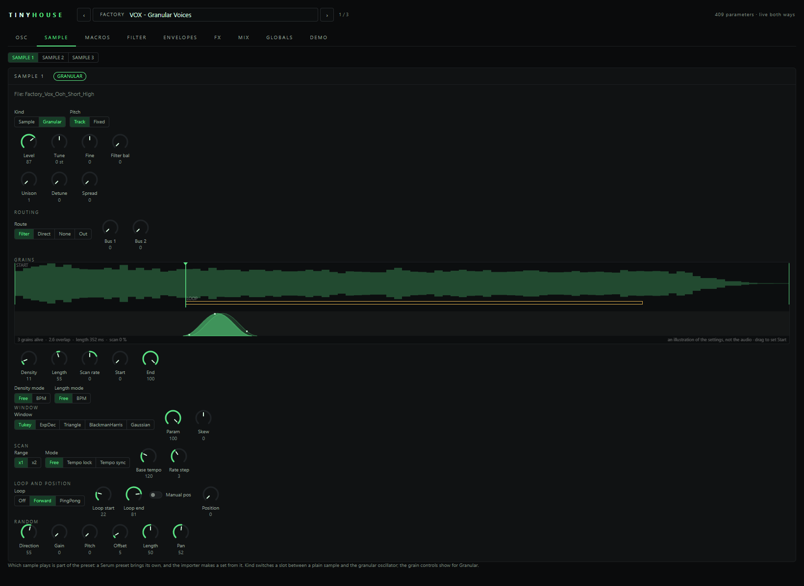
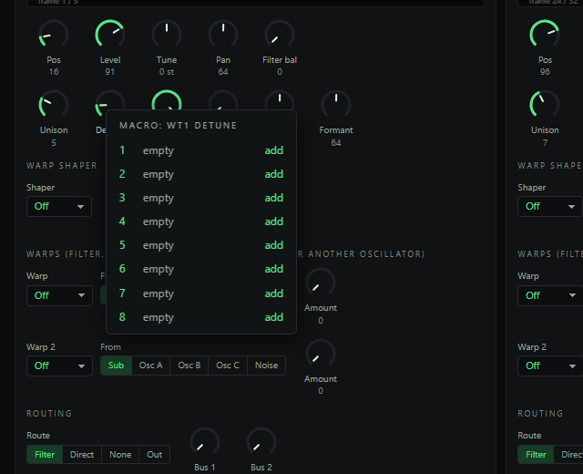
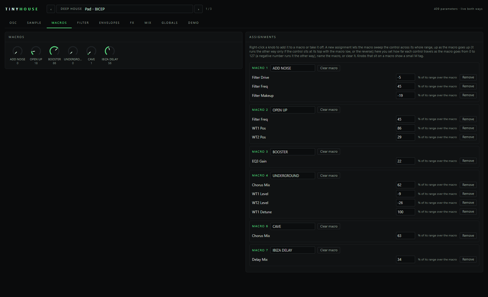

# TinyHouse

**A wavetable synth for the Ableton Move, inspired by Serum 2 and Vital, that plays your own Serum 2 and Vital presets.**

TinyHouse is a sound-generator module for [Schwung](https://github.com/charlesvestal/schwung) (the Move's open module host). You bring Serum 2 presets (or [Vital](https://vital.audio) ones: `.vital` files, loose or in a `.zip`, are imported the same way);
TinyHouse converts them, and they play on the Move as native patches: polyphonic, with unison, filters, modulation, eight macros, a sample and granular
oscillator, and a full effects rack.

TinyHouse is its own engine on a small ARM box, not a copy of Serum or Vital: **expect an imported preset or pack to sound similar to, and clearly related to, the Serum 2
or Vital original, but not the same.** Some come out very close, some less so, and a bank will always have a few that miss. Some features are not built yet (see
[What is supported](#what-is-supported)), and a preset that leans on one of them loses that part of its sound; the import report says which. The same goes for Vital presets: the engine emulates Vital's oscillators, envelopes, filters and effects loosely, not exactly, and a Vital preset is not level-matched, so set its volume by ear.

**This is experimental.** Importing in the browser is the easy route; it sets loudness, reverb and width from general rules. If you have Serum 2 on Windows and
want presets to land closer to what you hear in the plugin, use the [Python scripts](#more-accurate-conversion-with-the-python-scripts), which can compare
each preset against your own copy of it.


## What you need

- An Ableton Move running [Schwung](https://github.com/charlesvestal/schwung), with the TinyHouse module installed on it (see [Installing](#installing)).
- Serum 2 presets (`.SerumPreset` files or a `.SerumPack`). Or Vital presets (`.vital` files, loose or zipped, or a `.vitalbank`; they carry their own wavetables and samples, so they need no other install). Nothing from Xfer or Vital Audio is included.
- Serum 2 installed on your computer, for any preset that uses Serum's own wavetables or samples (most factory presets do). Serum's installer puts those files in your
  `Documents\Xfer\Serum 2 Presets` folder, and TinyHouse reads them from there; the plugin itself does not have to run. Without that folder those oscillators are silent.
  Wavetables and samples stored inside the preset file itself are imported with it and need nothing from Serum 2. Serum 2 on Windows is also needed for the more accurate
  [Python route](#more-accurate-conversion-with-the-python-scripts) (with Python 3.13).

The browser import runs the converter inside the page, so it needs no Python on your computer, but the browser needs internet access (it loads the Python runtime from a CDN).

## The workflow

1. **Bring a Serum 2 preset.** Drop a `.SerumPreset` (or a pack) on the remote UI's Import dialog. It is converted in your browser and stored on the Move.
2. **Fine-tune it on the remote UI.** Every control is live in both directions with the Move: wavetables, samples, unison, filter curve, envelopes, effects.
3. **Put the eight controls you care about on macros.** Right-click any knob and choose a macro. One macro can move as many controls as you like.
4. **Jam on the Move.** Pick the sound, play, and work the macros and the performance pages. No computer is needed from here; the sound is saved with the slot and your set.

## Getting started

1. **Install the module** (see [Installing](#installing)): build it and copy it to the Move over SSH.
2. **Open the remote UI.** Go to the Schwung manager at `http://move.local:7700`, choose **Remote UI**, and put TinyHouse in a slot. Use a normal browser window: the import needs one.
3. **Import your presets.** Click the preset name in the header, then **Import**:


- Choose or drop `.SerumPreset` files (or a `.SerumPack`), or Vital presets (`.vital`, or a `.vitalbank`, which gets a bank of its own named after the file: they carry their own wavetables and samples, so they need no folder; they are not level-matched, so set the volume by ear. The Vital converter is GPL-3.0-or-later, see [THIRD-PARTY.md](THIRD-PARTY.md)). If a preset uses a wavetable or sample that is not stored inside it (Serum's own tables, the audio of
  Sample oscillators, recorded noises), the import asks for your Serum 2 folder: drop `Documents\Xfer` on the dialog, press **Choose folder…**, or press **Import
  without them** to leave those oscillators silent. Only the files the presets use are copied to the Move.
- **Chrome's "Upload N files to this site?" prompt** appears when you choose a folder. Nothing is uploaded: the page reads the folder in your browser and sends only
  the files your presets use to the Move. Dropping the folder on the dialog avoids the prompt. For a folder picker that remembers your Serum folder (Chrome and
  Edge), add the Move's address (e.g. `http://move.local:7700`) to `chrome://flags/#unsafely-treat-insecure-origin-as-secure`, enable it and relaunch.
- For a whole bank at once (Factory, a pack), use **Import whole banks from this folder** and tick the banks.
- Press **Import**. Loose presets go into a bank called *Imports*, a pack or folder into a bank of its own name. A report lists each preset as *imported*,
  *imported with parts missing* (and which) or *not imported* (and why).

4. **Play.** The new bank is in the preset browser. Pick a sound and it loads on the Move.

Your presets go nowhere but your Move: the converter runs inside the browser page (which downloads the Python runtime it uses from a public CDN the first time).

## Tweaking and playing

**Fine-tuning is on the remote UI**: tabs along the top (Osc, Sample, Macros, Filter, Envelopes, FX, Mix, Globals, Demo). The Osc tab has
three oscillators with 3D wavetable displays, and the **Sample** tab has the three sample slots (sample or granular, with a picture of the grains). On the **FX** tab every control in an effect's slot wears that effect's colour. Drag the
filter curve and envelopes, pick wavetables from the list, set the effects, and save the result as a preset. The import report's loudness, reverb and width come
from general rules, so set **Volume** and the effects to taste.

**Distorted or clipping?** A few presets come out louder than the Move's output can carry, and they crackle or distort on loud passages. Turn **Master Gain** down until it is clean: it is the last knob (VOL) on the Tone page, and also on the Voice page and in the Output panel of the Globals tab on the remote page. The slot keeps the new gain with your set, and you can save it as a preset from the remote page.



**Playing live is on the Move**, with no menus:

| Page | What is on it |
|---|---|
| **Main** | filter freq, res and envelope amount, decay, sub, width, space, bank |
| **Tone** | the three wavetable positions drawn as waves (an oscillator that is off shows an empty slot), attack, release, drive, high shelf, volume |
| **Macros** | the preset's eight macros as two rows of four dials, each with its name over a value bar; an unused macro is an empty slot |
| **Effects**, **Mod FX** | each effect on or off, drawn as the chain, with its main controls |
| **Voice** | voice mode, **Voices**, **Unison Cap**, glide, glide mode, legato, pitch-bend range, volume |
| **Grain 1-3** | the sample's shape with its scan head, start point and loop, above eight knobs: Density, Length, Scan, Start, Kind, Loop mode, Loop start, Loop end |
| **Demo** | plays a MIDI part from a folder on the Move so you can audition a bank; it waits for Play and joins on the next bar |

**If it clicks or glitches, turn down Unison Cap and Voices** (both on the **Voice** page). The Move renders every slot on one audio thread, so a busy set
(four slots, long unison stacks, a reverb on each) can run out of time for a block. **Unison Cap** limits every oscillator's unison stack in the selected slot;
fully up (16) leaves each preset as made. It is a live limit, not part of the sound: it is not stored in presets, so loading another preset keeps your setting
(it does come back with a saved set). Fewer **Voices** is the second lever.

Preset browsing is smooth: the name follows the knob at once and the sound loads once the knob has rested for a moment.

### Macros you set yourself

Any preset can have macros, not only the ones that came with a Serum preset. **Right-click a knob** on any tab and a menu lists the eight macros. Pick one and the
knob shows a small **M** tag; turning the macro, on the Move or the page, moves it. Right-click more knobs and pick the same macro to put as many as you want on it.
Each keeps its own travel, so one macro can open a filter a little, bring a reverb up a long way and pull a delay down.



- **Assigning never changes your sound.** The first control you put on a macro stays exactly where it is, and the macro's knob moves to match it. From then on the control follows the macro across its whole range, bottom to top.
- **Adding more controls.** A second control is moved to where the macro's knob is, so all the controls on that macro read the same and move together.
- **Moved a control by hand?** The macro no longer matches it. Press **Match knob** on the Macros tab and the knob jumps back to the first control. Nothing else moves.
- **Part-way or backwards.** Each control starts with the whole range, going up. Set a smaller or negative number on the Macros tab to run it part-way or the other way.
- The **Macros** tab lists what each macro holds. Name a macro (the Move shows the name), set how far each control travels as the macro goes from 0 to 127 (a
  negative number runs it the other way), take a control off, or clear a macro.
- Assignments are saved with the slot and come back with your set. A macro with nothing on it has no name and stays hidden on the Move.



## The effects chain

The effects are laid out as a rack in the order a Serum 2 preset uses them:


| Stage | Serum 2 effect it stands in for | |
|---|---|---|
| Distortion | Distortion | tanh, biased, hard clip and sine curves |
| Filter FX | Filter | static or following the filter envelope; low-pass, high-pass, band, notch |
| Compressor | Comp | single band and three-band multiband |
| Mod FX | Chorus, Flanger, Phaser | real modulated stages |
| Width | HyperDimension | spread and level |
| Delay | Delay | tempo-synced to the Move, band-pass in the feedback, ping-pong |
| Reverb | Reverb | size, decay and damping |
| EQ | EQ | four bands |
| Master | Utils | width, mono-below, soft output clipper |

There are also **two FX buses**, each a full copy of the rack, with their own oscillator and filter sends as in Serum.

## What is supported

**Carried across**
- Serum 2 presets and packs (`.SerumPreset`, `.SerumPack`), and Vital presets and banks (`.vital`, `.vitalbank`).
- Three wavetable oscillators with unison to 16 voices, a sub and a noise oscillator; stepped or interpolated wavetable position; fixed-pitch and pitch-envelope oscillators.
- Warps: bend, PWM, sync, even/odd, the filter warps, and FM, phase-distortion, ring-mod and AM warps driven by the Sub or another oscillator (two per oscillator), with LFO and envelope routes into their amounts.
- Sample and multisample oscillators (from your Samples folders), and the **granular oscillator** (density, length, scan, start, loops, scan range, tempo and BPM modes, random settings, unison).
- Two filters, in parallel or series: ladder, high-pass and low-pass models, notch, band-reject, Exp, Scream, RM and DJMixer models, the formant models, and the comb, flange and phase models, each matched to the closest engine filter.
- Envelopes, four LFOs, the arpeggiator, and routes from macros, velocity, note number, mod wheel and random sources. A synced LFO follows the Move's tempo.
- The whole effects chain and both FX buses, including the reverb and convolution reverb of a Split band; Convolution (Space) reverbs use the impulse response from Serum's Impulses folder or the preset.

**Not carried yet**
- FM, ring-mod and phase-distortion warps driven by the noise or by Filter 1; DLM, spectral tables, Sync Var.
- Reverb filter models, and the rarer comb variants (Comb2, Combs).
- A second distortion, compressor or delay; a filter placed before the distortion; sends moved by an LFO or envelope (the Distortion's Wet follows one).
- The Bode frequency shifter: a preset whose only unsupported effect is a Bode imports without it and the report says so.
- In Split and SplitMS branches, only the Distortion, Chorus / Flanger / Phaser (Distortion only for SplitMS), EQ and band reverbs are carried; a HyperD, Delay,
  Comp or Bode in a branch, and an EQ ahead of the distortion, are not.
- Serum 1 presets (Serum 2 only). A Vital chorus, flanger or phaser that is tempo-synced still runs at its 120 BPM rate.

A preset using something in the second list still imports, with that part left out, and the report says which.

### Known limits

Read these before you rely on it for a gig. TinyHouse is an early release (0.9).

- **It sounds similar to the Serum 2 or Vital original, not identical.** Levels, filters, effects and the stereo image are matched against Serum (and, for Vital presets, measured against Vital), but some presets land closer than others. Reverb tails run 1 to 3 dB quieter than Serum's and the wet signal builds up a little faster.
- **Not every preset comes across.** Of Serum 2's 626 factory presets, 363 import well enough to install. The rest use something listed under "Not carried yet" (Bode and some Filter FX models are the biggest groups) and are skipped, or import with that part left out. The import report says which.
- **Tempo-synced chorus, flanger and phaser (Vital) do not follow the Move's tempo.** They run at their rate at 120 BPM. Synced LFOs do follow it.
- **Heavy presets use a lot of CPU.** A dense granular preset is the most demanding thing it plays. If a set with several heavy slots crackles, use fewer of them or lighter presets.
- **The Move's wavetable list stops at 128 tables.** The WT1 to WT3 Table knobs list the first 128 tables of the library, or of the pack you pick with the WT Pack knob. A pack with more than 128 tables shows only its first 128 there.
- **Macros: eight per slot, and the mapping is yours to keep tidy.** Assigning a macro never changes the sound, but if you move a control by hand afterwards the knob and the control drift apart until you press **Match knob**.
- **You need your own Serum 2 files.** Nothing from Xfer or the preset authors is in this repository, and Serum 1 presets are not supported.

## More accurate conversion with the Python scripts

The Python importer does the same conversion but can also **play each preset through your own installed copy of Serum 2** and compare. That lets it:

- **Set the loudness** of every preset from a measurement, instead of using one general offset.
- **Set the reverb and width** from a measurement.
- **Check the result**: it compares octave-band levels with that render and leaves out a preset that ends up too far from it, with the reason in a
  `skipped_<bank>.md` report. It is stricter than the browser: a preset that uses something unsupported is dropped, not imported with a part missing.

You need Serum 2 (the VST3 plugin) installed on Windows, Python 3.13 and a bash shell for the deploy scripts (Git Bash is fine). The files the importer needs are in
`calibration/` (see [calibration/README.md](calibration/README.md)); the measurement probes it was built from are not in the repository.

```
pip install -r requirements.txt
python converter/import_pack.py "C:\path\to\folder of .SerumPreset" --bank "My Pack"      # converts, renders in Serum, fits levels; writes out_import/My Pack/
BANK="My Pack" sh ./deploy_wavetables.sh                                         # copy to the Move over SSH (each step keeps a rollback copy)
sh ./deploy_samples.sh
SRC="out_import/My Pack" BANK="My Pack" sh ./deploy_presets.sh
```

For Serum's own Factory presets, point it at `Presets\Factory` in your Serum 2 folder with `--bank Factory`; it keeps only presets that match Serum's render
(about 360 of the 626) and takes hours, because every preset is rendered. If it stops, run the same command again with `--resume`. Reload the slot afterwards and
the bank is in the preset browser. `converter/deephouse2move.py` converts a `.SerumPack` directly, and `converter/serum_paths.py` explains how Serum's folders are
found (set `SERUM_ROOT` and `SERUM_VST` if yours are elsewhere). Renders are cached, so a second run is fast. [docs/DEVELOPMENT.md](docs/DEVELOPMENT.md) has the
options and rules.

## Installing

TinyHouse is not in Schwung's module catalogue yet, so install it from this repo. You need Windows, macOS or Linux, a Move running Schwung that you can reach over
SSH, and [zig](https://ziglang.org) to build the ARM module.

```
bash schwung-tablor/scripts/zig-build.sh arm           # builds schwung-tablor/build/dsp.so
python schwung-tablor/tools/build_import_bundle.py     # the converter the remote UI's Import runs
bash schwung-tablor/scripts/deploy.sh ableton@move.local
```

**Without zig:** download `tinyhouse-module.tar.gz` from the [Releases](https://github.com/fleshinachair/TinyHouse/releases) page, unpack it on your computer, and copy the
`tinyhouse` folder to `/data/UserData/schwung/modules/sound_generators/` on the Move with `scp -r`, as the `ableton` user. That is for a first install. To upgrade a module
that is already loaded, upload `dsp.so` under another name and rename it into place (or use `deploy.sh`): never copy over a `dsp.so` the Move is running.

Then reload the slot (or restart the Shadow UI) so the new module loads. `deploy.sh` replaces the module safely while the Move is running, and first checks that
the Move's `/` and `/data` are still root-owned (`scripts/move_check_owner.sh`).

**Copy to the Move one file at a time, as the `ableton` user, never as root.** Extracting a directory tree as root once changed the owner of `/` and `/data` and
locked out SSH, which needed a recovery image to fix. Run `move_check_owner.sh` before and after any copy.

## Where TinyHouse keeps its files, and removing it

Everything goes to the Move's `/data` partition, visible in Schwung's file manager (`http://move.local:7700/files`). A bank is a folder name used in three places:

| What | Where |
|---|---|
| Presets (`<name>.json`) | `/data/UserData/schwung/presets/tinyhouse/<bank>/` |
| Wavetables (`.wav`) | `/data/UserData/UserLibrary/Wavetables/<bank>/` (tables stored inside a Serum preset: `<bank>/embedded/`) |
| Sample sets (`.tbs`: Sample and Multisample oscillators, convolution impulses `conv_<id>.tbs`) | `/data/UserData/UserLibrary/Samples/<bank>/` |
| Demo parts | `/data/UserData/schwung/midi/tinyhouse/` |
| The module (`dsp.so`, the remote UI page, the converter) | `/data/UserData/schwung/modules/sound_generators/tinyhouse/` |

Importing only *reads* your Serum files; nothing in your Serum folders changes. For each preset, the wavetables and samples it uses are converted and sent to the
bank's own folders, next to the preset's `.json`, which names them by full path.

- A file is sent only if it is not already there (same size and same start, middle and end), so re-importing a pack is quick. A preset with the same name in the same bank is replaced.
- Each bank keeps its **own copy** of what it uses, even when another bank uses the same table. That costs disk space but a bank can be deleted on its own.
- Nothing is deleted automatically. **Delete bank** (remote UI) removes the bank's presets and its `Wavetables/<bank>` and `Samples/<bank>` folders, keeps a folder
  another bank still uses, and never removes the wavetable packs that come with the module (`Factory`, `Adventure Kid`, `Neu KatalYst`).

**Uninstalling.** Removing the module in Schwung's Module Store removes only the module folder; presets, sample sets and wavetables stay, so a reinstall finds
them. To remove everything, delete in the file manager: `schwung/presets/tinyhouse` and `schwung/midi/tinyhouse`; your banks' folders inside `UserLibrary/Samples`
and `UserLibrary/Wavetables` (leave other modules' folders alone); and the marker file `UserLibrary/Wavetables/.tablor-seeded` (harmless to keep).

## For developers

The converter, the importer that matches loudness, reverb and width against Serum, the calibration harness, the translation rules and the roadmap are in
[docs/DEVELOPMENT.md](docs/DEVELOPMENT.md). Contributions are welcome: see [CONTRIBUTING.md](CONTRIBUTING.md).

## Licences and what is not here

The engine is a fork of [Tablor](https://github.com/athousanddetails/schwung-tablor), itself a port of FigBug's [Wavetable](https://github.com/FigBug/Wavetable),
under BSD-3-Clause (see `schwung-tablor/LICENSE`). The rest of TinyHouse (the converter, the remote page, the scripts and the docs) is also BSD-3-Clause: see [LICENSE](LICENSE), **except the Vital import** (`converter/vital_*.py`), which is derived from [Vital](https://github.com/mtytel/vital) and is GPL-3.0-or-later: see [THIRD-PARTY.md](THIRD-PARTY.md) and [LICENSE-GPL-3.0](LICENSE-GPL-3.0). Parts of the engine are also ports of Vital's algorithms, so the **built engine (`dsp.so`) in a release is GPL-3.0-or-later as a whole**; the source files keep their own licences.

This repository contains **no Serum presets, packs, wavetables, samples or renders**, and no presets converted from them: those belong to Xfer and the preset
authors. You convert your own. Check a pack's licence before sharing presets you converted from it.

TinyHouse is not affiliated with or endorsed by Xfer Records, Ableton or the Schwung project. "Serum" is a trademark of Xfer Records; "Move" is a trademark of Ableton AG.
