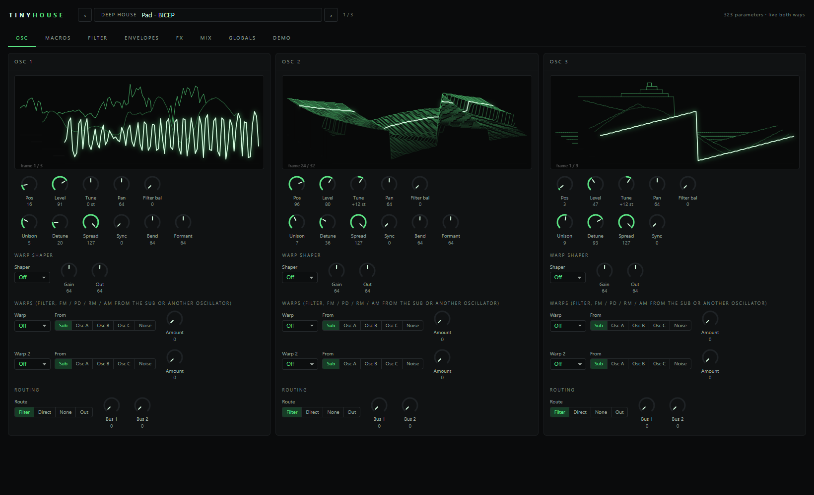
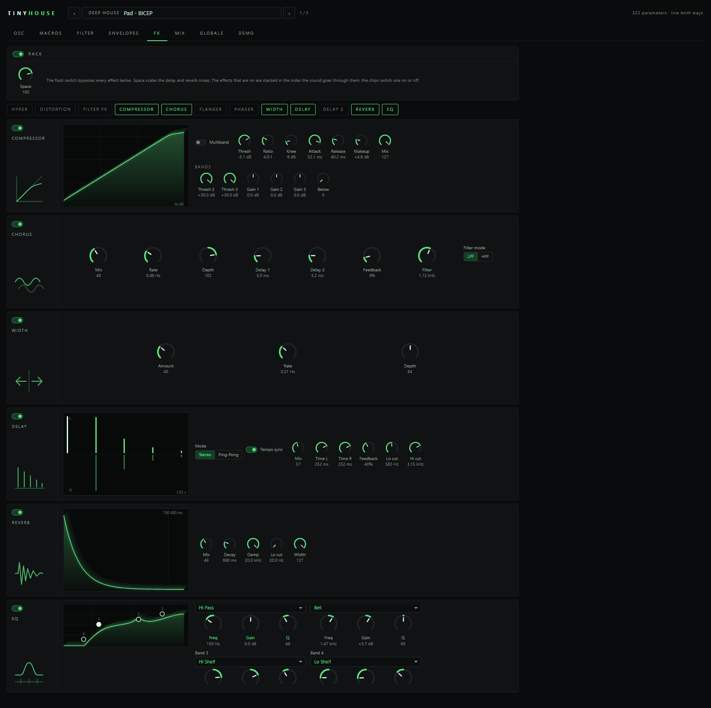

# TinyHouse

**A wavetable synth for the Ableton Move, inspired by Serum 2, that plays your own Serum 2 presets.**

TinyHouse is a sound-generator module for [Schwung](https://github.com/charlesvestal/schwung) (the Move's open module host). It is built for people who already
have Serum 2 presets they like and want to take them on the Move. You bring the presets; TinyHouse converts them, and they play on the Move as native
wavetable patches: polyphonic, with unison, filters, modulation, eight macros and a full effects rack.

It is a re-creation, not Serum. Every setting is translated from what Serum itself does, and the filters, effects and levels were measured against the real
plugin, but it is a different engine on a small ARM box: **expect presets to sound close, and a little different.** Some features are not built yet
(see [What is supported](#what-is-supported)), and a preset that leans on one of them will lose that part of its sound.

**This is experimental.** TinyHouse is young and the converter is still being tuned. Importing in the browser is the easy route, but it has no copy of
Serum to measure against, so it sets loudness, reverb and width from general rules. If you have Serum 2 on a Windows computer and want a preset to come
out as close as possible to the original, use the Python scripts instead: they render each preset through the real plugin and match the level, reverb and width to it
(see [More accurate conversion with the Python scripts](#more-accurate-conversion-with-the-python-scripts)).



## The workflow

1. **Bring a Serum 2 preset.** Drop a `.SerumPreset` (or a whole pack) on the remote UI's Import dialog. It is converted in your browser and stored on the Move.
2. **Fine-tune it on the remote UI.** Everything is a live control, in both directions with the Move: wavetables and their positions, unison, the filter curve, envelopes, the whole effects rack. Change a knob and you hear it on the Move straight away.
3. **Put the eight controls you care about on macros.** Right-click any knob, on any tab, and choose a macro (see [Macros you set yourself](#macros-you-set-yourself)). Name them if you like. The Move shows them as its eight macro knobs.
4. **Jam on the Move.** Pick the sound, play, and work the eight macros and the performance pages. No computer is needed from here; the sound is saved with the slot and with your set.

## Getting started

## Getting started

**1. Install the module.** TinyHouse installs beside any other Schwung modules, under its own name (`tinyhouse`). Build it and copy it to the Move
(you need the Move on your network, SSH access to it, and a zig compiler; see [Installing](#installing)).

**2. Open the remote UI.** On a computer on the same network, open the Schwung manager at `http://move.local:7700`, go to **Remote UI**, and put TinyHouse
in a slot. This page is where you import and fine-tune sounds. (Use a normal browser window: the import needs one.)

**3. Import your Serum 2 presets.** Click the preset name in the header to open the browser, then **Import**:


- The simplest way: choose or drop one or more `.SerumPreset` files (or a `.SerumPack`). If a preset uses a wavetable or sample that is not stored inside
  it (Serum's own tables, the audio of Sample and Multisample oscillators, recorded noises), the import pauses and asks for your Serum 2 folder: drop
  `Documents\Xfer` or `Documents\Xfer\Serum 2 Presets` on the dialog (the Serum 2 folder is found from there), or press **Choose folder…**, or press
  **Import without them** to carry on with those oscillators silent. Only the files the presets use are copied to the Move.
- **Chrome's "Upload N files to this site?" prompt.** Choosing a folder makes Chrome ask this, with a number like 7,448. Nothing is uploaded: the page only
  reads the folder in your browser, and sends just the wavetables and samples your presets use to the Move. Chrome words the prompt this way for any page
  that reads a whole folder, and the page cannot change it. **Dropping the folder on the dialog** should not show it. To get a proper folder picker that
  also remembers your Serum folder (Chrome and Edge), add the Move's address (as shown in the address bar, e.g. `http://move.local:7700`) to
  `chrome://flags/#unsafely-treat-insecure-origin-as-secure`, enable it and relaunch the browser. Browsers only allow the remembered picker on a secure page,
  and the Move's page is plain http. With it, the dialog shows a **Your Serum 2 folder** row that opens already read next time.
- To import a whole bank at once (Factory, a pack), use the folder row or **Other ways to choose ▸ Folder…**, then open **Import whole banks from this
  folder** and tick the banks. You can also hand the importer the `Tables`, `Samples` and `Multisamples` folders in advance there.
- Press **Import**. The presets are converted in your browser and stored on the Move, loose presets in a bank called *Imports* and a pack or folder in a
  bank of its own name. A report lists every preset as *imported*, *imported with parts missing* (and which parts) or *not imported* (and why).

**4. Play.** The new bank is in the preset browser. Pick a sound and it loads on the Move.

Your presets go nowhere but your Move: the converter runs inside the browser page (which downloads the Python runtime it uses from a public CDN the first time).

## Tweaking and playing

**Fine-tuning is on the remote UI.** It is laid out after Serum: tabs along the top (Osc, Macros, Filter, Envelopes, FX, Mix, Globals, Demo), and on the Osc tab
three oscillators with 3D wavetable displays. Every control is live in both directions with the Move. Drag the filter curve and envelopes, pick wavetables from the
list, set the effects, and save the result as a preset of your own. The import report's loudness, reverb and width are set from general rules (the
importer has no Serum to compare against), so set **Volume** and the effects to taste.

**Playing live is on the Move itself.** The pages are built for performance, with no menus:

| Page | What is on it |
|---|---|
| **Main** | filter freq, res and envelope amount, decay, sub, width, space, **Unison Cap** |
| **Tone** | the three wavetable positions (an oscillator that is off shows an empty slot), attack, release, drive, high shelf, volume |
| **Macros** | the preset's eight Serum macros, as dials. A macro the preset does not use is shown as an empty slot. Touch a knob and the top bar shows its name and value |
| **Effects**, **Mod FX** | each effect on or off, with its main controls |
| **Voice** | voice mode, **Voices**, **Unison Cap**, glide, glide mode, legato, pitch-bend range, volume |
| **Demo** | plays a MIDI part from a folder on the Move so you can audition a bank: it waits for Play and joins on the next bar |

**If it clicks or glitches, turn down Unison Cap and Voices.** The Move renders every slot's sound on one audio thread, so a busy set (four slots, long
unison stacks, a reverb on each) can run out of time for a block and click. **Unison Cap** is the last dial on **Main**: it limits every oscillator's
unison stack, wavetable, sample and Hyper alike, in the slot you have selected, and it is one turn away mid-performance. Fully up (16) leaves each preset
as it was made. Turned down it takes load off at once, usually without much change to the sound in a mix, and turning it up restores the full stack.
It is a live limit, not part of the sound: it is not stored in presets, so loading another preset keeps your setting (it does come back with a saved set).
**Voices**, on the **Voice** page, is the second lever: fewer voices means fewer simultaneous notes, and the oscillator budget is shared among them.

A preset's macros come across live: turning a macro moves the same parameters Serum's would (cutoff, effect mix, wavetable position and so on).

### Macros you set yourself

Any preset can have macros, not only the ones that came with a Serum preset. On the remote UI, **right-click a knob** (on any tab) and a small menu lists the eight
macros. Pick one and the knob is now on that macro: it shows a small **M** tag, and turning the macro, on the Move or on the page, moves it.


- A new assignment lets the macro raise the control from where it sits now to its top (a control already near its top goes down instead). Put several knobs on
  one macro to move them together: a cutoff and a reverb mix, say.
- The **Macros** tab lists what each macro holds. There you name a macro (the name is what the Move shows on that knob), set how far each control travels as the
  macro goes from 0 to 127 as a percentage of its range (a negative number runs it the other way), take a control off, or clear a whole macro.
- Assignments are saved with the slot and come back with your set. A macro with nothing on it has no name and stays hidden on the Move.


## The effects chain

Most Serum presets get half their character from the effects rack, so the rack is not an afterthought. TinyHouse has a full effects chain, and each stage was
measured against Serum with controlled test patches (not tuned by ear), so the effects follow Serum's own curves:



| Stage | Serum effect | |
|---|---|---|
| Distortion | Distortion | tanh, biased, hard clip and sine curves, with Serum's wet law |
| Filter FX | Filter | static or following the filter envelope; low-pass, high-pass, band, notch |
| Compressor | Comp | single band and three-band multiband |
| Mod FX | Chorus, Flanger, Phaser | real modulated stages |
| Width | HyperDimension | spread and level |
| Delay | Delay | tempo-synced to the Move, band-pass in the feedback, ping-pong |
| Reverb | Reverb | size, decay and damping |
| EQ | EQ | four bands |
| Master | Utils | width, mono-below, soft output clipper |

On top of that there are **two FX buses**, each a full copy of the rack. Oscillators and filters have their own sends to each bus, as in Serum.

## What is supported

**Carried across**
- Serum 2 presets and packs (`.SerumPreset`, `.SerumPack`).
- Three wavetable oscillators with unison to 16 voices, a sub and a noise oscillator; Serum's wavetable position, stepped or interpolated.
- Warps: bend, PWM, sync, even/odd, the filter (low-pass and high-pass) warps, and FM, phase-distortion, ring-mod and AM warps driven by the Sub or another oscillator (two warps per oscillator).
- Sample and multisample oscillators (from your Samples folders).
- Two filters, in parallel or in series: the common ladder, high-pass and low-pass models, and the notch, band-reject, Exp, Scream, RM and DJMixer models (each matched to the closest engine filter, measured against Serum).
- Envelopes, four LFOs, and the routes from macros, velocity, note number, mod wheel and random sources.
- The whole effects chain above, and the two FX buses.
- Convolution (Space) reverbs, with the impulse response from Serum's Impulses folder or stored in the preset.

**Not carried yet**
- FM, ring-mod and phase-distortion warps driven by the noise or by Filter 1 (the Sub- and oscillator-driven ones are carried), DLM, spectral tables, Sync Var.
- Formant, comb, flange, phase and reverb filter models (no engine equivalent yet).
- The granular oscillator (left silent).
- A second distortion, compressor or delay; the Bode frequency shifter; a filter placed before the distortion; sends moved by an
  LFO or envelope (the Distortion's Wet is the exception, it follows an envelope or LFO).
- Split and SplitMS branches carry the Distortion and the Chorus / Flanger / Phaser (the Distortion only, for a SplitMS) of one branch, with the EQ after them and the Distortion's own filter after the distorting; a HyperD, Delay, Comp or Bode in a Split
  branch, and an EQ ahead of the distortion in a branch, are not carried.
- Tempo-synced LFOs are read as plain rates in Hz.
- Serum 1 presets. Serum 2 only.

A preset using something in the second list still imports, with that part left out, and the import report says which. How closely it then sounds like
the original depends on how much of the sound that was.

## More accurate conversion with the Python scripts

The browser import is the easy way in, and it is deliberately approximate. The Python importer in this repo does the same conversion but also **plays each
preset through the real Serum 2 plugin** and measures it, so it can do three things the browser cannot:

- **Match the loudness** of every preset to what Serum produces, instead of using one general offset.
- **Match the reverb and width** to Serum's own (the browser sets them from fitted rules, so they are close but not measured per preset).
- **Check the result**: it compares octave-band levels against the Serum render and leaves out a preset that ends up too far from it, with the reason in a
  `skipped_<bank>.md` report. It is stricter than the browser: a preset that uses something TinyHouse cannot carry is dropped, not imported with a part missing.

You need Windows, the Serum 2 plugin (VST3),
Python 3.13 and a bash shell for the deploy scripts (Git Bash is fine).

```
pip install -r requirements.txt
python import_pack.py "C:\path\to\folder of .SerumPreset" --bank "My Pack"      # converts, renders in Serum, fits levels; writes out_import/My Pack/
BANK="My Pack" sh ./deploy_wavetables.sh                                         # copy to the Move over SSH (each step keeps a rollback copy)
sh ./deploy_samples.sh
SRC="out_import/My Pack" BANK="My Pack" sh ./deploy_presets.sh
```

To bring in Serum's own Factory presets, point it at `Presets\Factory` inside your Serum 2 folder with `--bank Factory`. It is the same three steps, and it keeps
only the presets that match Serum's render within the check above (about 290 of the 626). It takes hours, because every preset is rendered, so leave it running;
if it stops, run the same command again with `--resume` and it carries on where it left off.

Reload the slot afterwards and the bank is in the preset browser next to your imported ones. `deephouse2move.py` converts a `.SerumPack` directly and
`serum_paths.py` explains how Serum's folders are found (set `SERUM_ROOT` and `SERUM_VST` if yours are elsewhere). The first run on a pack is slow because
every preset is rendered; the renders are cached, so a second run is fast. [docs/DEVELOPMENT.md](docs/DEVELOPMENT.md) goes into the options and the rules behind them.

## Installing

TinyHouse is not in Schwung's module catalogue yet, so for now it is installed from this repo. You need Windows, macOS or Linux, a Move running Schwung that you
can reach over SSH, and [zig](https://ziglang.org) to build the ARM module.

```
bash schwung-tablor/scripts/zig-build.sh arm           # builds schwung-tablor/build/dsp.so
python schwung-tablor/tools/build_import_bundle.py     # the converter the remote UI's Import runs
bash schwung-tablor/scripts/deploy.sh ableton@move.local
```

Then reload the slot (or restart the Shadow UI) so the new module loads. `deploy.sh` replaces the module safely while the Move is running.

## Where TinyHouse keeps its files, and removing it

Everything TinyHouse writes goes to the Move's `/data` partition, and you can see all of it in Schwung's file manager (`http://move.local:7700/files`). Each
bank is a folder name, and the same name is used in three places:

| What | Where |
|---|---|
| Presets (`<name>.json`) | `/data/UserData/schwung/presets/tinyhouse/<bank>/` |
| Wavetables (`.wav`) | `/data/UserData/UserLibrary/Wavetables/<bank>/` (tables stored inside a Serum preset: `<bank>/embedded/`) |
| Sample sets (`.tbs`: Sample and Multisample oscillators, convolution-reverb impulses `conv_<id>.tbs`) | `/data/UserData/UserLibrary/Samples/<bank>/` |
| Demo parts | `/data/UserData/schwung/midi/tinyhouse/` |
| The module (`dsp.so`, the remote UI page, the converter) | `/data/UserData/schwung/modules/sound_generators/tinyhouse/` |

**How imported Serum files work.** Importing only *reads* your Serum files, in the browser. Nothing in your Serum folders is changed. For each preset, the
wavetables and samples it uses are converted and sent to the Move, into the bank's own folders above, next to the preset's `.json`, which names them by full path.

- A file is sent only if it is not already there. If the same file (same size and same start, middle and end) is on the Move, it is skipped, so importing
  a pack again is quick. A preset with the same name in the same bank is replaced.
- Each bank keeps its **own copy** of what it uses, even when another bank uses the same table. That costs disk space but means a bank can be deleted on its own.
- Nothing is deleted automatically. A file stays after you re-import a preset that no longer uses it, or delete a preset in the file manager.
- **Delete bank** (remote UI) removes the bank's presets and its `Wavetables/<bank>` and `Samples/<bank>` folders. It keeps a folder if another bank's presets
  still use it, and it never removes the wavetable packs that come with the module (`Factory`, `Adventure Kid`, `Neu KatalYst`).

**Uninstalling.** Removing the module in Schwung's Module Store removes only the module folder. Your presets, sample sets and wavetables stay, so a
reinstall finds them again. To remove everything, delete (in the file manager):

1. `schwung/presets/tinyhouse` and `schwung/midi/tinyhouse`.
2. The TinyHouse banks' folders inside `UserLibrary/Samples` and `UserLibrary/Wavetables` (the folders named after your banks, such as `Imports`).
   Leave the other folders there alone: other modules keep their files beside them.
3. `UserLibrary/Wavetables/.tablor-seeded`, a small marker file the module leaves. It does no harm if you keep it.

## For developers

The converter and the importer that runs on a computer with Serum 2 installed, which matches loudness, reverb and width against Serum, the calibration
harness, the translation rules and the roadmap are in [docs/DEVELOPMENT.md](docs/DEVELOPMENT.md). Contributions are welcome: see [CONTRIBUTING.md](CONTRIBUTING.md).

## Licences and what is not here

The engine is a fork of [Tablor](https://github.com/athousanddetails/schwung-tablor), itself a port of FigBug's [Wavetable](https://github.com/FigBug/Wavetable),
under BSD-3-Clause (see `schwung-tablor/LICENSE` for all the components).

This repository contains **no Serum presets, packs, wavetables, samples or renders**, and no presets converted from them: those belong to Xfer and to the
preset authors. You convert your own. Check the licence of a pack before sharing presets you converted from it.

TinyHouse is not affiliated with or endorsed by Xfer Records, Ableton or the Schwung project. "Serum" is a trademark of Xfer Records; "Move" is a trademark of
Ableton AG.
