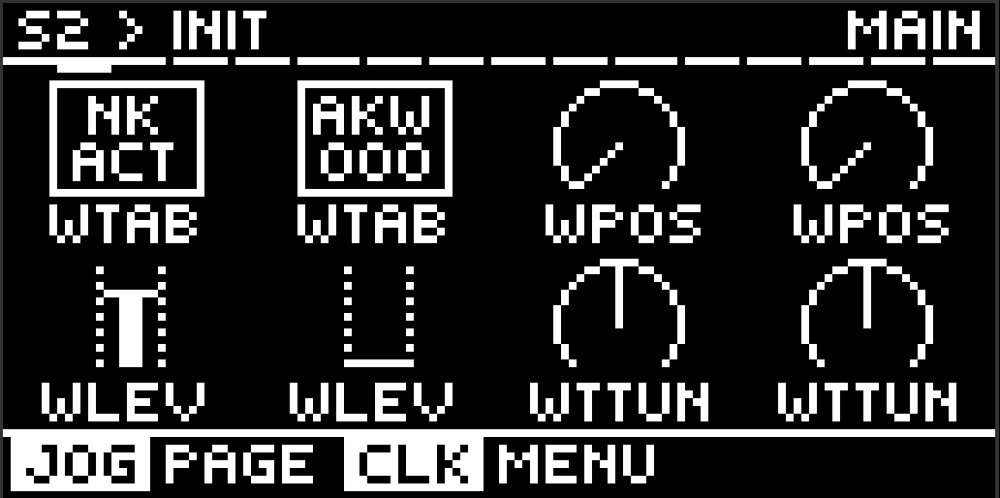
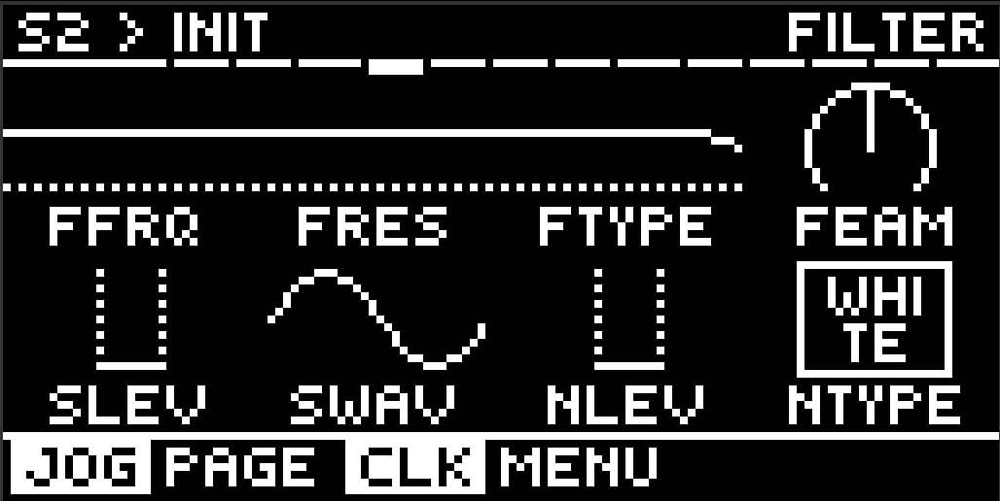
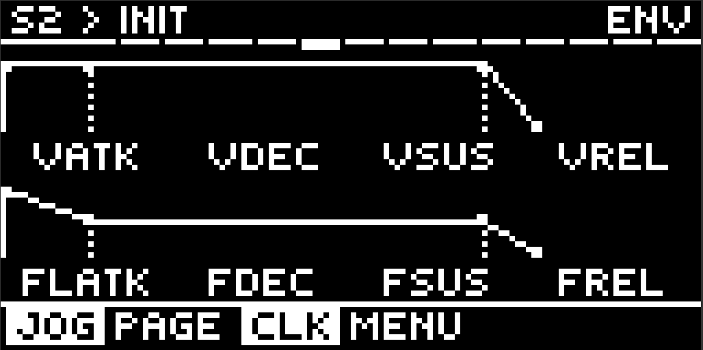

# Tablor

**A super-simple 2-oscillator wavetable synth for [Schwung](https://github.com/charlesvestal/schwung) on the Ableton Move.**

Tablor is built around one idea: switching wavetables should be the fastest,
most fun thing on the box. The first two knobs on the first page ARE the two
wavetables — turn one and the sound changes under your fingers. Everything
else stays out of the way.



9 pages, 71 controls on the device, no menus inside menus. The graphics are Schwung's own
— declared, not drawn by us — so the filter curve and both envelopes are the
real values:

| Filter | Envelopes |
|---|---|
|  |  |

## This fork

This is **TinyHouse** (`tinyhouse`), which installs beside stock Tablor
under its own module id and preset folder, so a store update to Tablor cannot
replace it. `release.json` and `docs/catalog-entry.json` still describe the
upstream release and are not used on the device.

## Features

- **3 wavetable oscillators** with position morphing, hard sync, and up to
  16-voice unison with detune + stereo spread. WT1 and WT2 also have bend
  (phase distortion) and formant shift; WT3 is the plain layer
- **A shared budget of 64 wavetable oscillators**, split by the Voices control:
  8 voices get 8 each, 4 get 16, mono gets them all. Stacks scale down to fit.
  **Unison Cap** (last dial on Main) lowers every stack live to save CPU
- **Sub oscillator** (sine / triangle / saw / square / pulse) and **noise**
  (white / pink)
- **Multimode filter** — LP / HP / BP / Notch, 12 or 24 dB/oct, with its own
  ADSR and key/velocity tracking, and a **drive** control that saturates going in
  and rounds off resonance coming out
- **Soft limiter on the output**, linear up to its knee, so a loud chord saturates
  instead of hard clipping
- **Space: the effects a preset carries.** A Schwung preset sets this module's
  parameters and nothing else, so the sounds that lean on delay, reverb and EQ
  have them built in: a **four-band EQ** (bell, shelf, high-pass or low-pass per
  band), **width** that adds side signal only so the mono sum is untouched, a
  **delay** (stereo or ping-pong, with a band-limited feedback) and an
  **eight-line reverb** with an explicit decay time. All off by default and
  bit-identical to the dry engine when off. **SPACE** on the main page scales the
  delay and reverb together (100 is the preset as made). Costs 0.04 to 0.05 ms a
  block on the Move with everything on
- **Four envelopes**: amp and filter, plus **two spare ones you can point at
  anything** — wavetable position, level, tune, bend, formant, pan, filter
  cutoff or resonance, sub, noise, amp — with a bipolar amount each. A
  decaying envelope on WT Position is what makes a wavetable sound struck
  rather than held; an LFO cannot do that shape, because it repeats
- For repeating movement, point one of Schwung's own slot LFOs at any Tablor
  knob from the slot settings
- **8 voices** polyphonic, or mono with glide/legato
- **A performance page first**: the device opens on cutoff, resonance, filter
  envelope amount and decay, sub, amp decay and release, and SPACE.
  Everything else is a jog away
- **Presets** live in Schwung's own preset store (the importer writes TinyHouse's
  banks there; the module can also seed a few factory sounds). Presets, modulation and knob mapping are all the host's: jog to the module's
  **My Presets** page and open **Preset**, and point a slot LFO or a mapped knob
  at any Tablor parameter from the slot settings
- **Web panel** — full control surface in the browser at
  `move.local:7700/remote-ui`

## Wavetables

All tables live in one folder on the Move:

```
/data/UserData/UserLibrary/Wavetables/
```

Drop wavetables there with Move Manager or the Schwung manager's file browser
— **Serum, Vital and Ableton exports all work**. `.wav` frame size is read
from the Serum `clm` chunk when present and inferred otherwise; Ableton's
FLAC-compressed `.wtNNNN` names its frame size in the extension. TinyHouse does not bundle wavetable packs: the importer writes each bank's own tables to the Move (see the top-level README). Tablor's original factory packs (Adventure Kid, Neu KatalYst) are not included in this copy.

On the device, WT1 and WT2 live on knobs 1 and 2 of the Osc page, and WT3 on
knob 1 of Osc 3.
Turn a knob to step through the library and hear each table as you land on
it; hold and click to open a full-screen scrolling picker when you want to
jump somewhere specific.

The file browser and the pack filter are in the **web panel** rather than on
the Move. Both used a control a knob cannot turn, so each one cost a whole
page on a four-cell screen — and the browser's graphic was Schwung's stock
`sample` shape, which is a fixed drawing that never reads the file, so it
told you nothing about the table you had loaded. The parameters still exist
and still save with the patch; they simply have no cell on the hardware.

## Web panel

Open `move.local:7700/remote-ui` for the full control surface, laid out after Serum 2: three oscillators
with 3D wavetable displays across the top, then tabs for the filters, envelopes, the effects rack, the
sub / noise / sample mixer and the globals. Every parameter the module declares has a control (the panel
builds itself from `chain_params`, and anything not placed lands in "More"), and every control is live in
both directions.

- **Preset browser** in the header: previous / next, and a searchable list of every bank. Picking a sound in
  another bank switches the Move to it. Needs the module's `preset_list` / `preset_now` keys (this build);
  an older module simply shows no browser.
- **Graphs you can drag**: wavetable position (drag across the waterfall), filter cutoff and resonance,
  envelope handles, EQ band nodes (wheel for Q). Readouts are in Hz, ms and dB where the engine's mapping
  is mirrored in the panel, and the raw 0..127 pot elsewhere.
- Not on the panel yet: the four LFOs, the mod matrix, the sample set choice, and the two FX buses' own
  racks (`b1.` / `b2.` keys). The module does not declare them to the host, so the panel cannot read them.

## Building

Cross-compiles for the Move (aarch64, glibc 2.35) in Docker:

```bash
./scripts/docker-build.sh        # inside ubuntu:22.04 with the aarch64 toolchain
```

`scripts/build.sh` is a convenience wrapper that builds on a remote host and
is specific to the author's setup. The build runs the native DSP test suite
and a config contract check; a red test fails the build. `tools/gen_params.py`
is the single source of truth for the whole parameter surface — module.json,
the device pages and the web panel are all generated from it.

## Credits & licenses

Tablor is a from-scratch Schwung port of **[Wavetable](https://github.com/FigBug/Wavetable)**
by **Roland Rabien (FigBug)** — the sound engine (wavetable oscillators,
band-limited mip tables, analog-style envelopes, filter behavior) is
ported from Wavetable and its DSP library **[gin](https://github.com/FigBug/Gin)**,
both BSD-3-Clause. The JUCE dependency was removed entirely; the DSP was
re-implemented as plain C++ against Schwung's plugin API, validated against
the original's behavior with numeric golden tests.

| Component | Origin | License |
|---|---|---|
| Synth architecture & DSP | [Wavetable](https://github.com/FigBug/Wavetable) / [gin](https://github.com/FigBug/Gin) by Roland Rabien | BSD-3-Clause |
| Filter core (SVF, MZTi) | AudioFilter by Michael Massberg (via gin) | BSD-3-Clause |
| FLAC decoding | [dr_flac](https://github.com/mackron/dr_libs) by David Reid | Public domain / MIT-0 |
| Pink noise | Voss-McCartney impl. by Thomas Merchant (via gin) | MIT |
| Host framework | [Schwung](https://github.com/charlesvestal/schwung) by Charles Vestal | — |
| Schwung port | [athousanddetails](https://github.com/athousanddetails) | BSD-3-Clause |

This module is **not** affiliated with Ableton. "Move" is a trademark of
Ableton AG.

## License

BSD-3-Clause — see [LICENSE](LICENSE). Factory wavetable packs keep their own
licenses as noted above.
